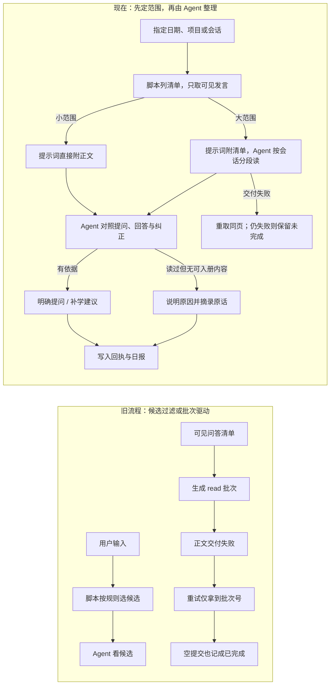

# dsh-workbench · 个人工作台

轻量个人事项管理：先记下要做的事，再随时放到某一周、某一天或具体时间。

稳定版安装与校验、Web 测试和发布流程见 [开发与发布](DEVELOPMENT.md)。

## 日常使用

- **记录一下**：顶部入口直接保存到待安排事项池。日列标题的加号继承日期，时间轴空白区域框选继承时间段。
- **就地编辑**：点击已有事项，直接在事项池、清单或项目行内改标题；时间轴和月视图使用日历底部编辑条。点项目或安排标签修改对应字段，「更多」里有备注和其他操作。收起或切换事项保留本次工作台内的草稿；点「保存修改」或在标题按 Enter 才保存，Esc 取消当前修改。
- **日程**：编辑器可切换「事项 / 日程」，日程选择日期后可设为全天或具体时段，支持可选地点。清单中日程独立分区、按时间排列；时间轴用日历图标和独立色调区分固定日程与待办时间块。飞书日程保留只读标识，本地日程可编辑、移动和调整时长。
- **事项池**：待安排与任意周的需求池位于日历侧边，可从池标题旁就近收起，收起后留下窄条原地展开，并记住状态。拖到日期或时刻，也可以拖回池中。跨周仍是同一事项，不创建副本。
- **清单 / 时间轴 / 月视图**：清单支持 1、3、7 天；时间轴整块点击编辑、跨天拖动、上下边缘调整开始和结束，支持键盘调整。月视图可拖入任意日期。
- **快速输入**：输入标题联想已有事项，未完成项可复用，已完成项可“再做一次”；项目可搜索、选择或输入新名称，通过稳定颜色标签识别。
- **已完成**：留在原日期、原排序位置，也保留在事项池。不会默认折叠。
- **待协作**：计划面板的独立区域汇集对话中需要你确认、选择、补充或操作的环节，不计入个人事项或日程。保留项目和来源，可标为已处理、忽略、重新打开或转入事项池；已处理记录仍可见。DSH 来源可直接打开对话，其他客户端可复制定位信息。已有普通事项可从编辑器移到待协作，支持撤销。
- **助手**：收集个人事项；主动点击才安排当天尚未指定时间的任务，避开固定安排和已同步的飞书忙碌时段。放不下就保留当天未排时间，不压缩、不重叠、不改到其他日期。
- **学习 / 整理记录**：继续保留知识阅读和后台整理来源记录。

修改保存、删除和移动均接入现有撤销机制。编辑器提供日期和周选择，作为拖动的键盘、触屏替代入口。

## 问题反馈

右上角「问题反馈」可输入描述、直接粘贴截图，也可拖入或选择图片。文字、截图可单独保存，每条最多 4 张 PNG/JPEG/WebP，每张最多 4 MB、合计 12 MB。关闭面板后再打开保留当前草稿；点击「保存问题」才持久化。已处理记录仍保留在列表，可以重新打开。

记录存放在实际工作台数据目录的 `feedback/<问题 ID>/issue.json`，截图在同一目录。默认 `~/.dsh/workbench/feedback`，设置 `DSH_HOME` 时跟随它；面板的「保存在本机」显示准确目录。反馈不进入事项列表、自动整理或撤销历史，不自动发送给 Agent。

「复制给 Agent」生成包含实际目录和命令的处理说明，也可以直接让本机 Agent 读取这些文件。仓库命令：

```sh
node scripts/feedback.mjs list
node scripts/feedback.mjs read <问题ID>
node scripts/feedback.mjs resolve <问题ID>
node scripts/feedback.mjs reopen <问题ID>
# 自定义数据位置时，追加 --root '/实际工作台数据目录'
```

Agent 应查看描述和截图、修复并验证后再标记已处理。新增接口需要重启 DSH 加载。顶部「撤销」撤回上一次可撤销的工作台修改；「刷新」重新读取工作台数据，不是刷新飞书日历。

## 不自动延期

跨天、跨周、启动、读取和升级不会自行改动安排。执行事项整理时，先核对完成和进展，再把已经过期且未完成的普通事项顺延到目标日（默认今天），并为目标日未定时间的事项安排空档。固定日程、已完成、暂停/取消、未来安排及事项池保持原位。只使用当前时刻之后的可用时间，空间不足或飞书读取失败时保留未定时间。已有旧版自动顺延存档保留，不猜测或回退过去的操作。完成时间用于完成统计，日历位置仍由安排日期决定。

## 飞书日历（只读）

打开日历工具栏的“飞书日历”，点击“复制配置 Prompt”交给自己的 Agent，并告诉它要关联哪个飞书机器人/应用。Agent 使用 Prompt 中的实际脚本路径和数据目录，确认应用、完成个人日历授权并验证读取；回到工作台点击“检查连接”，即可看到关联应用和连接结果。账号与日历字段收在高级设置中。

配置入口提供 `scripts/calendar.mjs` 的 `status`、`configure`、`check` 命令。`configure` 要求明确的 profile、App ID、应用名称，核对应用并真实读取用户日历成功后才保存。机器人消息通道在线不代表个人日历授权完成；工作台不接管其他 Agent 的消息通道。凭证由 `lark-cli` 管理，工作台不保存密钥或 access token。详细说明见 [Agent 配置说明](docs/feishu-agent-setup.md)。升级此接入模块后需重启 DSH 加载新的 Host 接口。

后端使用 `calendar events instance_view --as user` 获取重复日程实例，超过 30 天分段；缓存 60 秒，支持手动刷新。全天和跨日事件正常展示，已取消、拒绝的日程被过滤。飞书事件独立于任务存储，不可勾选、拖动、删除或写回；变更在飞书中完成。读取失败会显示错误，同一查询范围保留旧缓存；此时助手暂停自动分配时间，手动安排仍可使用。

## 个人待办边界

日历、待办与统计只展示本人要执行或确认的事项。自动整理的新任务必须附带归属类型和可核对的原文证据；助手内部 TODO、写代码、启动服务、跑测试、提交推送等委托执行步骤不能直接成为个人待办。助手消息可以更新已有事项的进展，或提取明确交给用户的确认请求。

旧版自动收集但缺少归属证据的记录会暂时从计划与统计中排除，不删除源数据。可在「整理记录 → 未计入我的待办」查看来源，并将确实属于自己的事项恢复；恢复操作支持撤销。

自动拆分已关闭，包括编辑详情、周目标、项目页与服务端 `decompose` 入口。复杂事项保留全貌，仍可手动添加行动和关联目标。重叠时间块按实际显示高度分列，短事项不会互相覆盖，右侧空闲列会被复用。

## 后台任务助手

默认每天 22:00 增量读取本机 DSH、Codex、Claude、ZCode 记录，合并同一事项、补充有依据的进展；没有明确日期的新事项进入待安排池。首次扫描最近 24 小时，后续按来源游标和内容哈希去重；分批处理积压。扫描本身不调用模型，没有新增材料时也不调用模型。

任务整理在固定的「任务整理」DSH 对话中执行：按工作台时区，默认同一个自然周内复用。手动与定时触发均留在当前页面，顶部显示可点击的执行状态；点击才打开对话，也可从「整理记录」回看。通用规则集中在 `src/organization-policy.js`，用户的时区、可用时段、项目与事项仅作为运行时数据注入；提示词不绑定特定用户、行业或代码仓库。初始提示词仅给出增量排查范围、对话摘要、当前事项数量和通用操作指引。Agent 通过 `workbench_organize_inspect` 按需列出对话、读取原文、搜索记录和查询实时事项（含已完成项）；先核对同一事项的后续结果，再决定新增、更新及排期。AI 创建的事项用小型 AI 标识显示来源，后续编辑保留来源。Agent 提交建议后，系统仍校验归属证据、排期与并发修改，再把实际保存结果作为工具回执返回对话。对话忙碌时不重复派发；对话已删除时重新创建，临时恢复错误保留原绑定。定时整理遇到运行中的 agent 会延后；关闭宿主期间不运行。

右上角「助手设置」统一配置任务与学习模型，以及晚间/间隔整理、来源、时区和来源。思考强度从宿主当前模型支持的档位中选择，任务与学习整理共用，下一轮生效；切换模型清除旧强度，不改宿主全局默认。模型未指定时使用宿主默认；迁移时优先沿用已有学习模型，没有则沿用原任务模型。手动日期和时段受到保护；新的用户消息明确改期时可以更新，模型生成期间发生的手工修改仍优先。

**对话与费用保护**：任务和学习各自复用。助手设置可选择自然周（周一）或自然月，亦可为其中一个点「下次整理用新对话」。到期或点按钮都不发送请求；实际启动才换新，不删除旧记录，新旧整理对话均排除在扫描外。原会话忙时不另开并行整理。直接在本期学习对话提要求也受保护；恰逢换期时仅把这次要求交给新对话，不回放旧历史。

任务整理只准检索和提交，学习整理只准收集、阅读和写入；禁止 shell、通用写状态和写学习收件箱。工作台不按时长、请求数、工具数或材料大小强停，也不覆盖模型的输出长度设置。每次续调前核对上一轮工具回执：读到新消息或新片段、发现新条目、实际推进保存位置，都可以继续。换参数、换批次号或换顺序却只返回旧材料，不算进展。允许重取或改查一次；仍在原地就取消 Agent，未提交的不算完成。无工具回执的重复请求、越权、提交失败、模型报错（含 429）均停止；完整提交后不再请求模型。复用的旧对话若含本类不允许的工具调用（例如 shell、写学习收件箱），首个请求也不发，请手动换新。正常历史不因大小而拦截。本地调用数和输入字节数只用于回看，不是账单。

助手设置里可明确授权某个已确认服务商限额的模型用于定时整理；不授权仍可手动整理。授权按供应商和模型匹配，不开定时开关，也不会自动设置或验证账户限额。定时整理遵循原有频率，无每日固定轮数；失败当天不自动重试，触发安全暂停后跨天也不会自行恢复，直到该类整理手动成功提交。正常分页和来源范围仍保留。


任务整理的 DSH/Codex/Claude/ZCode 适配器读取用户和助手文本：Codex 的最终回复、DSH 的 `data.message.content`、Claude 的主会话文件、ZCode 的只读 `message/part/session` 表。学习整理也读取这些可见问答，旧 CLI 候选预览仍只扫用户输入。模型名称（如 GLM）不作为记录来源，按使用它的客户端接入。

检索只允许本轮启用的来源、增量目录与已有任务关联对话；默认回溯最近 24 小时，之后按来源游标增量扫描，重叠 5 分钟并去重。读对话可向前分页、指定消息分块或查未处理消息；搜索结果与摘要不能作为落库证据。提交时给出 `reviewedSessions`，仅实际完整读取并确认核对的新增消息推进进度，未读、失败和未核对记录保留下一轮。分页大小只用于交付，不限制全轮总量。检索轨迹记录在当前执行对话及整理记录中。不会读取推理过程、图片内容或工具输出；对话中的“完成”也不等于独立验收，无法判断时保留待核实，不要求逐条确认才能生效。

## Agent 工具与外部入口

主动要求记事时仍可使用 `workbench_add`、`workbench_update`；新增计划字段包含 plannedDate、plannedWeek、kind、project、parentId、estimateMinutes、startMinute 和 order。`workbench_query` 支持 today / day / week / month / all / reviews / ideas，日周月可传 date 和 project。

普通执行会话不再注入任务记账规则或每步任务计数。原有后台执行结果收集继续保留。晨报会话推送默认关闭，只有明确配置 `briefingPush: true` 才开启。

## 学习模块（learn）

自动收集你在各 AI 工具里问过的知识性问题，判断分类并回答后写入 Obsidian，每晚出日报。
不实时记录，也不改会话内容。预筛只保留概念、原理、方法和区别类问题；整理 agent 再判断是否能脱离本次任务独立复习。
任务进度、界面反馈、一次性排障和催办不写入学习卡。没有可靠答案时跳过该条，不生成只有问题的笔记。

**数据源**（可开关，默认全开）：ZCode（`~/.zcode` 输入历史库）、DSH（`~/.dsh` 会话记录）、
Claude Code（`~/.claude/history.jsonl`）、Codex（`~/.codex` 会话记录）。扫描纯代码零模型成本，
手动或定时整理时调用所选模型（定时默认 22 点，费用按对应模型服务计费）。

四种触发方式：

| 方式 | 说明 |
|---|---|
| 对话里说「记一下这个问题」 | agent 调 `workbench_learn_capture` 一句话进收件箱，不打断当前任务 |
| `/学习任务` 指令 | 武装本会话；下一条消息被 Host `agent/pre-step` 拦截，**零模型调用**直接记为提问 |
| 每晚定时（默认 22 点） | 脚本列全范围内的会话 → 专用对话分批读问答 → 提交知识卡及实际覆盖进度 |
| `/闲时任务` 写「做一次学习整理」 | 复用闲时队列到点执行，与定时完全同一套指令 |

**Agent 工具**：`workbench_learn_collect`（会话清单、收件箱与知识点索引）、`workbench_learn_read`（分页读可见发言）、`workbench_learn_write`
（批量写 Obsidian 笔记 + 更新日报 + 消化收件箱）、`workbench_learn_capture`（手动记录）、
`workbench_learn_decide`（已掌握/忽略，同步笔记标记）。

**分类口径**：weak 弱项补强（反复问、核心概念不清）/ know 了解即可 / term 名词解释；
同概念（concept 字段）出现 ≥2 次未掌握进日报「查漏补缺」。

**面板「学习」视图**：左侧是问题与延伸分支，右侧阅读答案、查看来源与关联知识。点击知识点后输入追问，
会新建标题为「学习 · 问题」的 DSH 会话；原知识、选中原文和问题一并传入。
插件监听这个学习会话的持久消息事件：后续真人输入自动成为上一问题的延伸节点，回答自动回收到当前节点。
模型可以用 `workbench_learn_answer` 保存精炼答案；自动回收不依赖模型调用工具。
分支表示“从这里继续问”，不自动断言两个概念存在学术上的因果关系。跨主题知识可由 `relatedIds` 横向关联。

在原问题或答案中选中文字，可保存划线，也可带着划线追问。今日复习先隐藏答案，再展开核对并安排下次复习。
学习日报与笔记原文都在控制台内阅读；日报里的知识链接跳回知识点。「在 Obsidian 打开」使用经过文件存在性校验的绝对路径 URI，
外部应用调用仍取决于本机协议关联。文件移动不影响 state 中已记录答案；同步失败会显示错误并可手动重试。

**学习整理怎么选题**：由 Agent 判断，不由脚本给发言打分。下面是两种流程的差异：



在「学习整理」对话里直接说「重新整理昨天全天」即可，哪怕上轮已结束或宿主重启。不用返回工作台。普通对话也可以发起请求，但只收到派发状态。昨天按工作台时区的自然日计算，不用近 24 小时替代。手动范围（最多 7 天）可限定来源、项目或会话；它不推进日常整理水位，也不会丢掉被切走的未完成范围。未指定范围时优先续读；定时任务只续日常范围。

默认从上次完整日常整理的结束时刻开始，首次回看 24 小时。两类整理会话、思考、工具记录和图片均不作素材。小范围（最多 14,000 个正文字符、32 段）直接附进专用对话的启动消息；大范围先给清单，`read(sessionId)` 可指定阅读顺序，`read(afterBatchId)` 取得下一页，不需要读一页写一次。无参 `read` 会重发未提交页完整正文。只有 `write` 成功才推进已整理的位置；读失败、超时或中断不算完成。有正文但没有新知识点，须提交原因及末页原话；有知识点需引用来源发言。状态文件只保存清单、已提交位置与结果，不另存整份对话。

学习设置保留 Obsidian 库路径、库内目录、整理时间和扫描源，模型入口统一到「助手设置」。手动和定时学习整理使用独立 DSH 会话，
不修改日常会话或全局默认。固定标题为「学习整理」，与任务整理一样按配置周期复用；手动整理不自动跳转，顶部执行状态可点击进入此对话。每轮读取当前材料，根据写入回执汇报结果。两类整理对话都从扫描来源中排除，避免把整理输出再次作为候选。追问沿用共用模型，未指定时使用 DSH 默认模型。
所选模型不可用时不静默替换。
现有卡片自动兼容为独立知识点；新关系、划线与会话绑定保存在工作台 state，笔记同步为 Markdown。
切换库只影响新笔记，旧知识点保留原库路径。Host 行配置 `stateRoot` 可用于隔离验收数据，日常不必配置。

**生效边界**：更新 Host 后必须重启 DSH，刷新页面只更新客户端。新建会话自动命名，历史未命名会话不会自动改名。
仅自动记录从工作台发起且当前 Host 正在处理的学习对话；导入其他历史对话仍通过学习整理完成。

**Obsidian 落盘**（请在本机学习设置中选择库；默认不指定库）：

```
<notesDir>/YYYY-MM-DD-标题.md     学习笔记（frontmatter + 原问题/答案/为什么重要）
<notesDir>/日报/YYYY-MM-DD.md      学习日报（全天新增、今日待复习、查漏补缺、弱项清单）
```

外部进程（ZCode 等）走 CLI：`node scripts/learn.mjs scan --hours 48`（预览候选）、
`add '问题'`（补录）、`status`（统计与弱项）。

## ZCode / 外部会话汇入

`scripts/wb.mjs` 与插件共享同一份 `state.json`（store 按 mtime 重载，多进程安全）：

```bash
node scripts/wb.mjs add '整理 pitch 分享内容' --priority 2 --focus   # 幂等：同名未完结任务跳过
node scripts/wb.mjs progress pitch '素材已抓取，开始排版'             # 追加环节时间线（actor=ZCode）
node scripts/wb.mjs update pitch --status done
node scripts/wb.mjs idea '给工作台加个统计页'
node scripts/wb.mjs query today
node scripts/wb.mjs add '验证日历体验' --date 2026-11-13 --project 工作台 --estimate 45
node scripts/wb.mjs query week 2026-11-13
```

约定：只有用户明确要求记下的个人行动或确认事项才登记任务。委托 agent 执行的目标、内部 TODO 和工具步骤不能登记为用户待办。已有个人事项的里程碑用 progress 汇报，
有明确完成依据时置 done；需要验收的事项再等待用户确认。`DSH_HOME` 环境变量可改数据根目录。

## 数据与配置

- 数据在本机 `$DSH_HOME/workbench/state.json`（默认 `~/.dsh/workbench/`），桌面版、网页版与
CLI 共用；多进程使用文件锁与原子写入，按 mtime 重载。已完成任务、历史记录和学习卡长期保留；已处理结果按保留期清理。撤销按字段回退，保留不相关的后台更新。
- 行配置（`cordis.patch.yml` 里该行的 `config`）：
  - `watchJobs`（默认 `true`）：是否收集后台 job 的完成事件。
  - `briefingHour`（默认 `9`）：晨报推送的整点小时（0-23）。
  - `briefingSessionId`（可选）：晨报推送的目标会话；缺省自动取最近活跃的工作台会话。
  - `briefingPush`（默认 `false`）：设为 `true` 才启用会话推送。
  - `learnVaultPath`：旧版行配置的 Obsidian 库路径，面板中设置的路径优先；都未设置时不扫描库目录、不写笔记或日报。
  - 学习模块设置（库路径 `vaultPath`、笔记目录 `notesDir` 默认 `AI/Agent学习`、整理时间 `reportHour` 默认 22、
    扫描源 `sources`、推送开关 `reportPush`、目标会话 `reportSessionId`）在面板「学习 → 设置」
    修改，存 state 即时生效。

## 开发

```bash
npm install        # 开发依赖，React 在正式插件中由宿主提供
npm run dev:web    # 独立 HOME 的真实 DSH Web 宿主，加载当前源码
npm test           # Host 逻辑 + CLI 测试（node --test）
npm run build      # 打包 client/ → dist/client.js
npm run watch      # 监听 client/ 变更重新打包
npm run preview    # 隔离样例数据 + 真实 UI/HTTP，127.0.0.1:4317；不读取真实会话
```

目录：`src/` Host 半片（存储、ops、工具、提示、收集器、晨报、HTTP），`client/` 界面，
`scripts/wb.mjs` 外部汇入 CLI，`scripts/build.mjs` 打包脚本。改了 `src/` 要重启
DeepSeek Harness；改 `client/` 重新 build 后刷新页面即可。

## 路线图（未完成）

- 面板内嵌对话栏（对着任务直接派活）
- `/workbench` 人类命令
- 更丰富的完成趋势与项目统计

### 项目、日程与邮件（2026-11-13）

任务详情可「创建关联项目」：新建项目并关联原任务，原任务的 ID、状态和排期保持不变。日历清单用颜色标签显示项目归属；项目页可查看关联事项。任务列表和时间轴使用紧凑编辑窗，说明与材料可展开；项目页使用宽版详情。日程具有固定日期，会议占具体时段，提交截止等事项可作为全天日程，不自动顺延。

在「助手设置 → 邮箱接入」复制配置 Prompt 交给自己的 Agent，配置完成后点「检查连接」。技术字段默认收在「手动配置」，仍可自行输入并「保存并检查」。Agent 使用 `scripts/mail.mjs` 的 `status / configure / check` 命令，连接成功后才保存配置；检查读取的是已保存配置，不会覆盖 Agent 的修改。新授权码仅接受标准输入或工作台密码框，不放进命令参数。

邮件只读收取，正文交给当前整理模型识别个人处理、确认和日程事项；不下载附件、不改已读状态。连接检查不读取正文、不触发整理；自动收取默认关闭。授权码保存在本机数据目录下的 `mail-account.json`（0600），不进入工作台状态接口。配置前请在邮箱服务中开启 IMAP。当前支持应用密码，不支持 OAuth；详情见 [邮箱 Agent 配置](docs/mail-agent-setup.md)。

具体行为、接入限制与验证记录见 [项目、日程与邮件说明](docs/projects-events-mail-validation-20261113.md)。

## 事项与协作的整理边界

整理工具分别提交 `changes`（独立事项）和 `collaborations`（过程协作）。新事项要求 `scope: standalone` 与用户原文责任依据；助手的确认请求或粒度不明的本人动作先进入待协作。两类条目均读取来源上下文、核对完成情况与当前记录，不能从助手内部计划生成用户工作。

`workbench_organize_inspect(action="collaborations")` 支持按 ID、关键词、状态分页查询，包含已处理记录。协作解决需同一对话的后续原文证据；手动处理与并发修改优先。已转为事项的条目不再自动移回。历史误收动作只对未排期、未手动修改的 AI 池事项进行有依据的重分类；其他条目由用户从编辑器决定。重分类保留原始事项快照，手动转回池中沿用原 ID、备注、项目、进度与来源，并清空日期和时段。
